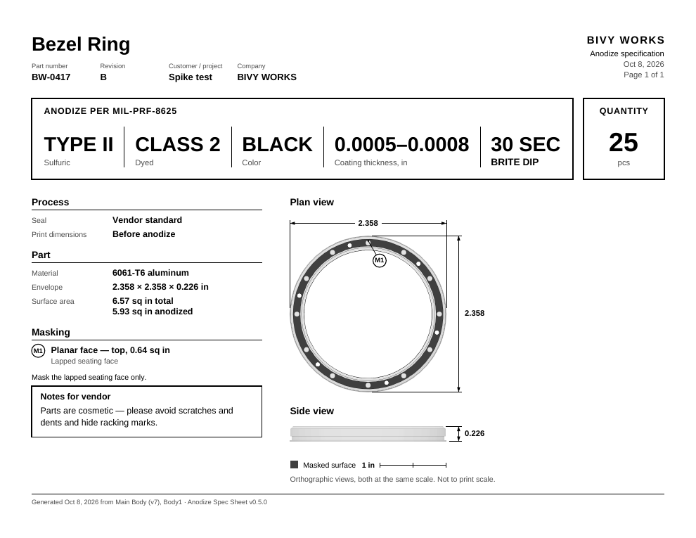
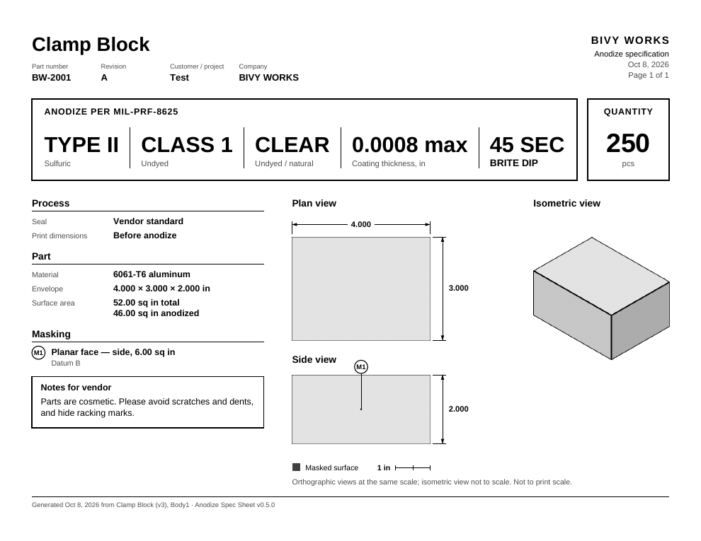

# Fusion Anodize Spec Sheet

A Fusion 360 add-in that turns one solid body into a one-page, black-and-white
anodize finishing specification PDF, ready to send to the anodizer: the
process callout (type, class, color, coating thickness, brite dip), part data,
masking callouts with numbered balloons, plan and side views rendered from the
model with overall dimensions, an isometric context view, and notes for the
vendor.



Everything runs on Fusion's own Python and the standard library: no
third-party packages, no network, nothing to install besides the add-in. The
PDF writer, the PNG/TIFF/BMP decoders and the page layout are all in the
repository.

## Requirements

- Autodesk Fusion with the Python API (tested on Fusion 2705.1.25, macOS,
  Python 3.14; Windows is supported by design and covered by the test
  matrix, but has not been tried inside Fusion yet).
- Nothing else.

## Install

1. Clone or download this repository somewhere permanent.
2. In Fusion: **Utilities → Add-Ins → Scripts and Add-Ins → Add-Ins tab → +**
   (the green plus) and pick the `BivyAnodizeSpec` folder.
3. Tick *Run on Startup* if Fusion did not already (the manifest asks for it).
4. The **Anodize Spec Sheet** button appears under **Utilities → Bivy Works**.
   If another add-in already created a "Bivy Works" panel, the button joins
   it; stopping the add-in removes only its own button, and the panel only
   when this add-in created it and it is empty.

After updating the files, Stop and Run the add-in in the Scripts and Add-Ins
dialog (or restart Fusion). The add-in reloads its own modules on every Run,
and the dialog's status line and the sheet footer both show the version that
is actually running.

## Usage

1. Select a body, or a face of it, and click **Anodize Spec Sheet** (it is
   also in the right-click menu of a body).
2. **Part** tab: part name (the design's file name, or the body / component
   name for unsaved designs), part number (from the component), revision,
   customer, company, quantity, material (mapped from the Fusion material;
   "Other…" reveals a text field) and temper. The info line shows the surface
   area and the L × W × T envelope of the minimum oriented bounding box.
3. **Anodize** tab: pick a preset (fills type, class, color and thickness; all
   fields stay editable), then seal, brite dip (required: the sheet never
   prints without an explicit choice) and whether the print dimensions apply
   before or after anodize.
4. **Masking & Notes** tab: click faces to mask (only faces of the chosen body
   are selectable), a masking note, notes for the vendor, *Flip view* to look
   at the part from the other side, and *Open PDF when done*.
5. **Generate**: choose where to save (the default name is
   `{PartNumber}_{Rev}_{PartName}_ANODIZE.pdf`). The add-in renders the plan,
   side and isometric views in a scratch document, lays out the sheet and
   opens the PDF. Cancelling the save dialog does nothing.

The status line at the top of the dialog shows the first blocking error (the
Generate button stays disabled) or soft warnings: a thickness outside the
usual range for the type, Class 2 with CLEAR, Class 1 with a dye color, a
material that is not aluminum or titanium.

### What is saved where

- The spec is stored as JSON on the body (attribute group
  `BivyWorks.AnodizeSpec`) and every masked face gets a `mask` attribute, so
  reopening the dialog on the same body restores everything. Set
  `PERSIST_SPEC_IN_DESIGN = False` in `config.py` to never write attributes.
- Last customer, company and save folder are kept in
  `~/Library/Application Support/BivyWorks/anodize_spec.json` (macOS) or
  `%APPDATA%\BivyWorks\anodize_spec.json` (Windows).
- Nothing else in the design is changed. The camera, visual style, visibility
  and active document are restored even when generation fails.

### The sheet



- Plan and side views share one scale and carry the overall dimensions; a
  scale bar sits below them. The isometric view is not to scale and goes
  beside the orthographic views when those are limited by the page height, or
  below them when a long part leaves room there.
- Masked faces render dark gray and are listed under *Masking* with a
  description (for example `4× Ø0.500 bore`) and a balloon on the view that
  shows them best.
- The callout strip auto-fits its text; long texts in the left column degrade
  gracefully (smaller notes, fewer masking lines, truncation) so the sheet is
  always exactly one page.
- Black ink and one 70 % gray only, 7.5 pt minimum, no color anywhere: it is
  meant for a black-and-white laser printer.

## Presets

`BivyAnodizeSpec/presets.json` holds the entries of the preset dropdown. A
`null` value leaves that field as it is; an optional `"brite_dip"` key
(`"none"` or seconds) pre-selects brite dip. Edit the file to match your
vendor's standard finishes.

## Configuration

Everything tunable is in `BivyAnodizeSpec/config.py`: the shared panel name,
render resolution and grays, the capture format and render approach, the
isometric view (`ISO_VIEW`), sheet defaults (company, spec standard, temper,
vendor note, default type / class / color), the material map, the thickness
sanity ranges behind the soft warnings, and every font size and layout
constant of the sheet.

## How it works

- `BivyAnodizeSpec/commands/anodizeSpec/entry.py` — toolbar button,
  right-click entry, the dialog, validation and attribute persistence.
  Generate fires a custom event; rendering and the PDF run in that event
  after the command has closed, because Fusion does not allow creating or
  closing documents inside command events.
- `geometry.py` — copies the body with `TemporaryBRepManager`, builds a
  canonical frame from the oriented minimum bounding box (L → X, W → Y,
  T → Z, right-handed), reads face data from the canonical copy, scores both
  sides for the automatic view direction, groups and describes the masked
  faces and picks balloon anchors.
- `render.py` — places the copy in a throwaway Direct-modeling document with
  neutral gray appearances, captures the plan, side and isometric views with
  orthographic cameras and a transparent background, then closes the document
  and restores the viewport. An in-place fallback hides everything else in
  the user's document instead.
- `raster.py` — decodes the captures (PNG, TIFF, BMP) without per-pixel
  Python loops, keys the background, crops to the part and normalises the
  print tones.
- `pdf_writer.py` — a minimal PDF 1.4 writer with Helvetica metrics from the
  Adobe Core 14 AFM files, Flate-compressed content and images with a soft
  mask.
- `sheet_layout.py` — the page itself; `spec.py` and `persistence.py` — the
  data model, presets, validation, attributes and local settings.

`docs/spike-notes.md` records the measurements made inside Fusion that
decided the render approach, the capture format and the tone handling.

## Development

Everything outside the rendering runs without Fusion:

```
cd BivyAnodizeSpec
python3 -m unittest discover -s tests -p 'test_*.py'
python3 tests/make_sample_sheet.py            # -> tests/out/sample.pdf
python3 tests/make_sample_sheet.py --block    # thick block: isometric view beside the others
python3 tests/make_sample_sheet.py --bar      # long bar: isometric view below the others
python3 tests/make_sample_sheet.py --spike    # real Fusion captures from reference/spike-2026-10-06
python3 tests/make_sample_sheet.py --long     # overflow handling; also --no-mask, --unicode, --no-iso
```

`tests/test_dialog.py` drives the real dialog handlers through
`tests/fake_adsk.py`, a small stand-in for the parts of the Fusion API the
dialog touches, including the quirks that matter (event arguments scoped to a
tab, programmatic text changes firing events, wrapper objects that do not
compare equal). `tests/fixtures/` holds a sample spec and synthetic renders
made by `tests/make_fixtures.py`; `tests/imgtools.py` writes PNG, BMP and
TIFF (LZW, PackBits) so the decoders are tested against known input.
`reference/` holds the layout mockup the sheet follows.

The GitHub Actions workflow runs the suite on Ubuntu, macOS and Windows with
Python 3.12, 3.13 and 3.14.

## Limitations

One body per sheet. No vector views (Fusion's automatic drawing API is still
a preview API); the views are rendered images at about 2400 px across the
part. Thread callouts, surface finish symbols and rack points are not on the
sheet. Fusion's own Python is the only runtime tested; the add-in needs
Python 3.12 or newer.

## License

MIT, see [LICENSE](LICENSE).
